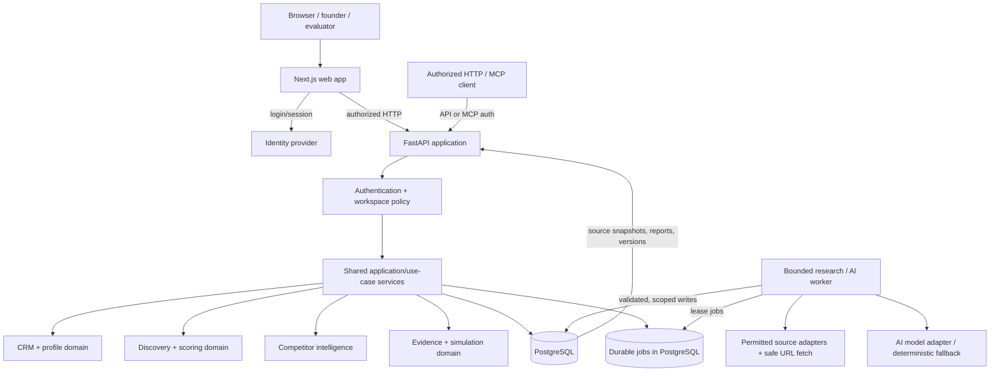
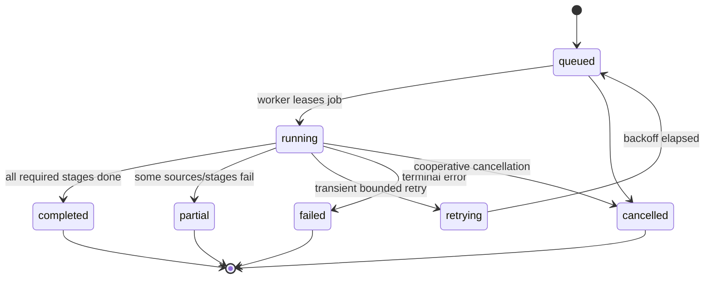
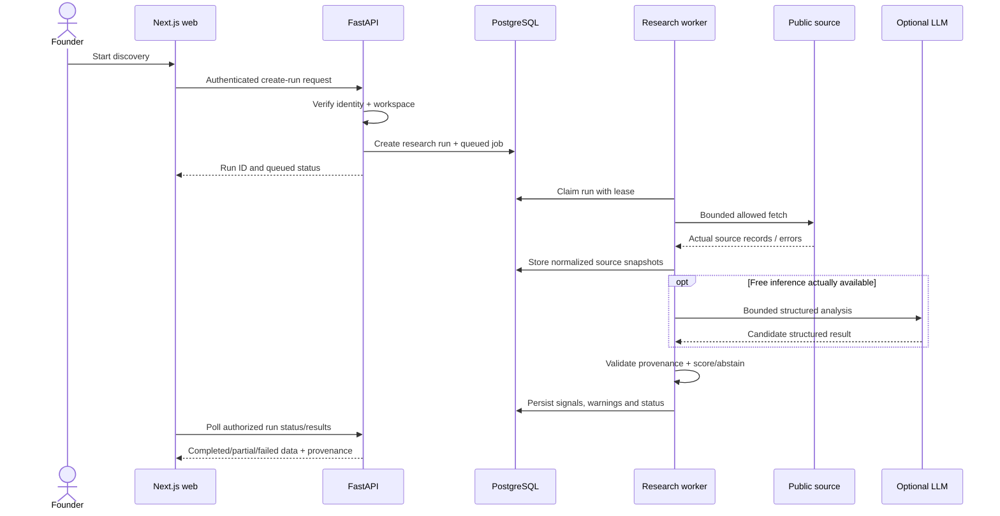

# Axiom — System Architecture

**Document path:** `docs/05-SYSTEM-ARCHITECTURE.md`  
**Project:** Axiom — AI-native market and competitive intelligence  
**Program:** YARC Builder Fellowship 2027, Track 04 (Acquire + Differentiate)  
**Version:** 1.0 — approved  
**Prepared:** 18 November 2026  
**Status:** APPROVED — founder approval 18 November 2026  
**Release target:** 26 November 2026, 11:59 PM IST  
**Normative product references:** [Approved PRD](02-PRD.md), [Approved MVP](03-MVP.md), [Approved User Flows](04-USER-FLOWS.md)  
**Documentation navigation:** [01-INDEX.md](01-INDEX.md)

> **Architecture thesis:** Build one coherent, securely isolated product with a deliberately **modular backend**, an independently runnable **bounded research/AI worker**, PostgreSQL as the durable system of record, and shared domain services for the web app, HTTP API, and MCP. Research and AI must generate **inspectable evidence artifacts**, not just plausible narratives.

## 0. Authority, status, and decision boundaries

This document proposes the technical **how** for the already approved product **what**. The founder approved the architecture on 18 November 2026. It is not a claim that any code, connector, provider, or deployment exists; unresolved vendor and free-tier feasibility decisions remain open.

- The approved PRD and MVP take precedence over this draft for product requirements.
- References to technologies, services, costs, source APIs, limits, and route names in this draft are **proposals** unless explicitly labeled an approved product requirement.
- Do not infer that a product feature has been implemented from diagrams or schema examples.
- As specified by the repository index, coding agents must read the actual root `AGENTS.md` and `ENGINEERING.md` and this index before implementation; this document does not replace their rules.
- The single evaluator flow remains **landing → login → authenticated app**, with normal, privately provisioned low-privilege credentials. No guest-only path or judge-only demo page is part of this design.
- Priorities **P0** and **R0** retain their approved meaning. Architecture must accommodate the broader **R0** source, simulation, CRM, and MCP objectives without describing them as already delivered or silently deferring them.

### Architecture decision status

| Decision | Proposal | Status |
|---|---|---|
| A-01 | Modular FastAPI backend rather than distributed microservices | Proposed |
| A-02 | Next.js + TypeScript web application | Proposed |
| A-03 | **Supabase-hosted PostgreSQL** as durable primary store | **Approved — ADR-002; not yet deployed/benchmarked** |
| A-04 | **Supabase Auth** for authentication and session issuance | **Approved — ADR-002; configuration unverified** |
| A-05 | Long-running research executed by an independent process from the same Python codebase, with a durable PostgreSQL job queue | Proposed |
| A-06 | Typed, evidence-first relational records/edges; no graph database initially | Proposed |
| A-07 | Provider-agnostic structured LLM adapter with deterministic fallbacks, zero planned paid API use | Proposed |
| A-08 | HTTP REST plus authenticated MCP using shared application/use-case layer | Proposed |
| A-09 | Server-owned external URL ingestion with SSRF and prompt-injection boundaries | Proposed |
| A-10 | Hosting, runtime limits, worker feasibility and CI provider choice | **Unresolved: verify before approval** |

The founder's approval of this architecture should be followed by separate, short ADRs for consequential technical choices. Until then this is a proposed design, not a hidden architecture mandate.

## 1. Architecture goals and constraints

### Goals

1. **One verified founder journey:** sign in → select workspace → confirm idea/product → discover demand → source-backed competitor research → evidence verdict and graph → counterfactuals → persistent CRM.
2. **Plausible evidence lineage:** every material factual claim points to a retained evidence record with source URL/locator, fetch time, origin type, and limitations.
3. **Separation of responsibilities:** the main API owns identity, authorization, validation and business workflows; AI/research modules own acquisition, extraction, enrichment and explanation; the worker executes expensive tasks.
4. **One truth across interfaces:** Next.js, documented HTTP clients and MCP clients call the **same domain services** and share permissions, result types and persistence.
5. **Multi-workspace safety:** no account, MCP token or background job can access an unrelated user's workspace.
6. **Graceful degradation:** free AI or source outages cannot produce fake live results. Deterministic discovery filters, structured comparisons, saved evidence and clear failure messages continue where possible.
7. **Low operational complexity:** no requirement for Kubernetes, Kafka, Redis, graph database, separate vector DB, dedicated GPU, or several independently deployed microservices for the initial release.
8. **Upgradeable boundaries:** extra data adapters, specialized models, later scheduled monitoring and more advanced CRM tools attach without rewriting the core domains.

### Constraints / non-goals

- **₹0 planned external AI/research API spend.** This does not prove that hosting, compute, database egress, AI model quotas or public platform APIs are free or currently available.
- **November 26 submission deadline.** A deep architecture that cannot be deployed and tested in time is inferior to a smaller, honest, functioning architecture.
- **Broad, industry-neutral positioning** but no assertion of equally strong coverage in every sector.
- **Controlled agents** with human approval for sensitive writes; no automatic contact, scraping behind access controls, or unsolicited marketing automation.
- **Advanced R0 objectives remain:** 3+ permitted source families targeted, multi-assumption/multi-scenario Counterfactual Lab, richer CRM flows, and expanded MCP tool surface.

## 2. Recommended logical architecture



**Important trust boundary:** the public web browser and third-party MCP clients are untrusted. Authentication and workspace authorization are checked server-side for **every** private operation. The AI model and fetched websites are **not** sources of authority.

### Deployment/process boundaries (initial preference)

| Process/service | Responsibilities | Scaling / failure boundary |
|---|---|---|
| **Next.js frontend** | Landing, login, authenticated routes, onboarding, opportunities, evidence graph/report, scenarios and CRM | Can deploy independently; never receives private provider secrets |
| **FastAPI application** | JWT/session verification; authorization; business orchestration; REST; MCP gateway; API schemas; job submission/status; health | Stateless API processes; short requests only |
| **Python research worker** | Claim bounded jobs; fetch permitted sources and competitor pages; run classification/extraction; validate LLM outputs; persist evidence; signal status | Independently restartable process using same backend package, **not necessarily a separate service repository** |
| **PostgreSQL** | Product data, durable job queue, audit, source snapshots, versioned assessments, CRM | Transactions and constraints keep cross-service state coherent |
| **Identity provider** | Login, account provisioning, sessions | Preferred Supabase Auth; provider choice pending validation |
| **External source/model services** | Public posts/sites, optional free LLM inference | Untrusted and availability-limited; partial errors visible |

**Why two Python processes rather than two backend microservices?** The main backend and AI pipeline need different *execution characteristics*, not necessarily separate independent network APIs. A stateless FastAPI request server and a worker process can share domain types, versioned schemas, DB transactions, and CI while keeping slow web fetches/LLM calls off request threads. Only split into separately owned microservices if throughput, security isolation, or team boundaries justify the operational cost.

**Critical feasibility check:** a free host may sleep, limit persistent workers, or have no background process allowance. No queue design is approved until an actual worker process can claim/finish jobs on the intended host. A bounded, server-managed on-demand fallback is acceptable **only if** it reliably completes within real hosting limits and reports timeouts/partial state honestly; a development-only background task does not prove production durability.

## 3. Proposed technology stack and alternatives

| Concern | Preferred candidate | Why | Fallback / risk |
|---|---|---|---|
| Product frontend | Next.js, React, TypeScript | Existing skills, cohesive public and authenticated product, responsive rich interaction | Avoid locking framework version before dependency/hosting compatibility check |
| API and domain | Python FastAPI, Pydantic | Typed API contracts, research/AI ecosystem, service boundaries | Verify deployment/worker behavior |
| Storage | **Supabase-hosted PostgreSQL (approved choice)** | Strong transactions, relational integrity, JSONB where necessary | Check free quota, connection/pooling behavior and long-running job viability |
| Identity | **Supabase Auth (approved choice)** | Provisioned evaluator login and managed sessions | Exact session flow, JWKS verification and account provisioning must be proven |
| Data access/migrations | **SQLAlchemy 2.x + Alembic (approved choice)** | Typed repositories, transactions and versioned migrations | Prove migrations, DB pool and role isolation |
| Async work | PostgreSQL-backed jobs with leased worker | No Redis/Kafka requirement; durable state and retries | If free worker infeasible, run bounded tasks with explicit timeout/status |
| Public-source adapters | HN public API, selected RSS/Atom, Bluesky if independently validated; public URL input | Permitted acquisition and observable data provenance | HN official API is item-oriented, not a general full-text search engine; adapter needs an honest indexing/query strategy |
| Competitor extraction | Safe HTTP HTML fetch + constrained text extraction; selective crawl tooling only if needed | Bound network and content risk | JS-heavy and blocked pages may remain unknown |
| LLM inference | Swappable free-access model provider(s), output-schema validation | Model flexibility and failure fallback | **No provider or free quota assumed available yet**; without real inference do not claim AI analysis worked |
| Graph visualization | Client graph library with typed node/edge DTOs | Evidence graph can be interactive without graph DB | Accessible report/list is mandatory |
| MCP transport | Python MCP SDK / current compatible Streamable HTTP | Real external integration; shared domain logic | Confirm client compatibility/auth against supported protocol revision before committing |
| Tests | pytest, Playwright, type/lint/build quality gates | Contract, isolation and deployed E2E evidence | Actual commands and CI workflow follow engineering standards |
| Hosting | Compatible frontend/API/worker hosts + managed DB | Flexible with deployment budget | Must test independent worker, HTTPS, secrets, free-tier limits |

**Not proposed for MVP:** managed Kafka, paid vector DB, graph DB, microservice mesh, autonomous outreach service, GPU-dependent inference, or unbounded crawlers. For "semantic" ranking, model-assisted structured relevance and/or small in-process embedding batches are optional only if real free provider/hardware capacity is demonstrated. Deterministic search + honest model-unavailable disclosure is the minimum fallback, **not equivalent** to shipped AI intelligence.

## 4. Repository boundaries and module layout (proposal)

```text
axiom/
├── apps/
│   └── web/                       # Next.js public + authenticated interface
├── services/
│   └── api/
│       ├── pyproject.toml
│       └── app/
│           ├── main.py           # HTTP server composition
│           ├── api/v1/           # REST routes, request/response DTOs
│           ├── auth/             # token validation + workspace policies
│           ├── application/      # use-case orchestration
│           ├── domain/
│           │   ├── workspaces/
│           │   ├── discovery/
│           │   ├── competitors/
│           │   ├── evidence/
│           │   ├── simulations/
│           │   └── crm/
│           ├── infrastructure/
│           │   ├── persistence/
│           │   ├── sources/
│           │   ├── extraction/
│           │   ├── ai/
│           │   └── jobs/
│           ├── mcp/              # typed tool adapters to application layer
│           └── worker.py         # same codebase, separate runtime entrypoint
├── contracts/                    # generated OpenAPI schemas / contract artifacts
├── tests/                        # unit, API, integration, E2E
├── docs/
│   ├── 01-INDEX.md
│   ├── 02-PRD.md
│   ├── 03-MVP.md
│   ├── 04-USER-FLOWS.md
│   └── 05-SYSTEM-ARCHITECTURE.md
└── infra/                        # environment examples and deployment config
```

This is a **module boundary sketch**, not a mandate to create all empty folders now. Prefer lean subpackages when code exists. The web client should use generated or schema-checked API types, not copy/paste diverging interfaces.

### Domain responsibilities

| Domain | Owns | Must not own |
|---|---|---|
| **Identity/workspaces** | Authenticated principal resolution, workspace membership, account isolation | Model prompt logic |
| **Product profiles** | Idea/live stage, confirmed capabilities and constraints, profile versions | Live source ingestion |
| **Discovery** | Search configurations, normalized signals, dedupe, source provenance, ranking inputs | Outreach sending |
| **Competitor intelligence** | Competitor candidates, user confirmations, sourced features/pricing/positioning and comparisons | Fabricated competitor facts |
| **Evidence/assessment** | Claims, graph relationships, missing evidence, verdicts, reports, evidence snapshots | Direct external side effects |
| **Simulation** | Baselines, named scenarios, qualitative assumption changes, comparison against frozen evidence | Revenue prediction without data |
| **CRM** | Leads, stage transitions, notes, follow-ups, drafts, audit records | Unconsented cold campaigns |
| **Research execution** | Job lifecycle, provider adapters, quotas, retries, failure outcomes | Workspace authorization bypass |
| **API/MCP adapters** | Inputs, outputs, auth envelope, errors, transport concerns | Parallel business logic or private database shortcuts |

## 5. Data architecture and persistence rules

**Database technology/hosting provider is selected in [ADR-002](decisions/002-authentication-database-and-api-boundary.md), but provisioned infrastructure and exact schema are not verified.** Relational storage is adequate for an inspectable evidence graph at this scale; the graph is a set of typed, attributable relationships over source-backed records.

### 5.1 Conceptual entities and ownership

| Entity / concept | Key invariant |
|---|---|
| `users` | Auth identity; no public arbitrary claim of identity |
| `workspaces` | Owned by or explicitly accessible to an authenticated user |
| `product_profiles` / `profile_versions` | Founder-confirmed context; versions immutable after use in assessments |
| `research_runs` / `research_jobs` | Every search/extraction tied to workspace, profile version, status, invocation source |
| `source_records` / `source_snapshots` | Canonical URL/source ID, observed/retrieved time, content excerpt, origin type, safe bounded content |
| `signals` / `signal_scores` | Source-linked candidate plus individually explainable relevance/intent/fit/evidence dimensions |
| `competitors` / `competitor_claims` | Each material external claim ties to a source snapshot, locator/excerpt, verification status |
| `assessments` | Deterministic and AI components, verdict, reason codes, model metadata, profile and evidence snapshot versions |
| `evidence_nodes` / `evidence_edges` | Typed graph entities and edge type, linked to assessment and source/assumption references |
| `scenarios` / `scenario_assumptions` | Frozen baseline assessment/evidence revision, multiple editable assumptions, versioned comparison |
| `leads` / `notes` / `followups` | Persistent CRM records with workspace ownership, timestamps and audit trail |
| `outreach_drafts` | Editable unsent drafts; never imply delivery |
| `activity_events` / `tool_audit` | Redacted significant mutations, tool caller, workspace, event result |
| `job_attempts` / `provider_calls` | Timeouts, errors, bounded cost/quota counters, timestamps, no secret payloads |

**Key strategy:** internal UUID-like IDs for domain objects; source IDs/canonical URLs for dedupe; foreign keys preserve evidence/research lineage. Workspaces are present in every workspace-owned table or reachable through strongly enforced ownership constraints. Prefer normalized columns for queryable fields and **bounded JSONB** for raw model result metadata; avoid an opaque everything-in-JSON schema.

### 5.2 Required invariants

- **Workspace isolation:** every cross-tenant read or write is denied regardless of endpoint type. API/MCP permissions are not delegated to the model.
- **Profile versioning:** an assessment points at the precise founder-confirmed product version and research snapshot used.
- **Evidence immutability:** already cited source snapshots are append-only or versioned. Refresh creates a new revision; it does not retroactively rewrite history.
- **Scenario repeatability:** baseline and variants refer to one frozen evidence revision; edits produce a new scenario revision. Reanalysis after fresh research is explicit.
- **Provenance integrity:** cited claims refer to existing source records and locators/offsets, with origin flags such as `live`, `cached`, `user_provided`, `seeded`, `inferred`, `hypothetical`, `unknown`.
- **CRM idempotency:** duplicate saves of the same signal/workspace cannot silently create competing leads; use constraints or idempotency keys as appropriate.
- **Audit privacy:** useful technical events without leaking tokens, secrets, raw private drafts or excessive personal data into logs.
- **Deletion:** owner-controlled deletion/retention scope for profile, CRM, cached source data and AI artifacts is to be specified in database/security documents.

### 5.3 Relational evidence model versus graph database

**Recommendation:** PostgreSQL tables for nodes, edges, linked claim records and snapshots. Query related nodes by assessment ID and build graph DTOs server-side. This enables ordinary referential integrity and avoids adopting Neo4j infrastructure for a modestly sized interactive graph. Revisit only after measured query bottlenecks.

## 6. Authentication, authorization, and credentials

### 6.1 Access pattern

1. Landing page is public. Authenticated app routes and API/MCP are protected.
2. User logs in via the selected identity provider; frontend stores sessions with appropriate framework-specific protections.
3. Each API request validates provider-issued identity server-side (issuer, signature/JWKS, audience, expiry and other applicable claims). **Never** trust an arbitrary caller-supplied user ID.
4. Application resolves workspace access via its authorization layer for each operation; switching the visible workspace alone gives no access.
5. Background jobs carry a persistent originating workspace and authorized initiator; the worker rechecks job ownership/scope and writes only to that same workspace.
6. MCP credentials are scoped to an explicit user/workspace and allowed tool capabilities; no unrestricted shared server token.
7. Evaluator account is provisioned beforehand as a normal, low-privilege account and handed over privately; it cannot access a backdoor or admin route.

### 6.2 Supabase-specific caution (if adopted)

Use Row Level Security (RLS) where relevant as an additional tenant boundary, but **do not assume RLS protects server operations made with privileged credentials**. Supabase secret/service-role credentials can bypass RLS, so privileged backend and worker operations must enforce workspace policy explicitly, ideally using least-privileged DB connections and automated negative tests. Never expose secret/service keys to the browser.

**Approved via [ADR-002](decisions/002-authentication-database-and-api-boundary.md):** All browser, HTTP and MCP **domain-data** reads/writes go through FastAPI. Supabase's public client SDK may handle browser authentication only; no direct browser domain-table reads/writes. Apply app-layer ownership checks to every private operation and RLS as defense in depth where applicable, including server privileged-credential bypass tests.

### 6.3 Authorization matrix (initial)

| Operation | Public | Authenticated workspace user | Authorized MCP client | Research worker |
|---|---|---|---|---|
| Landing/login | Allowed | Allowed | N/A | N/A |
| Read private product/research/CRM | Denied | Allowed in own workspace | Allowed with scoped read grant | Only for originating job workspace |
| Start discovery/competitor research | Denied | Allowed within quotas | Scoped tool-specific permission | Execute authorized job only |
| Save lead/update stage/follow-up | Denied | Allowed in own workspace | Explicit scoped write capability + approval/audit semantics | No unapproved end-user mutation |
| Edit product profile | Denied | Allowed in own workspace | Only if separately granted/approved (not initial default) | Denied |
| Send email/cold outreach | Denied | **Not supported in MVP** | **Not supported** | **Not supported** |
| Administration/provision evaluator account | Denied | Founder/operator only through trusted admin workflow | Denied | Denied |

**MCP write approval design is open:** a client-granted narrow `crm:write` scope alone may be sufficient for low-risk lead saves only if the user explicitly authorized that client and can audit/revoke access. Sensitive changes may require explicit per-action confirmation or a queued approval artifact. Define the exact behavior in MCP spec before implementing any write.

## 7. Research, ingestion, and scoring pipeline

### 7.1 Pipeline stages and data artifacts

```mermaid
flowchart LR
  A[Confirmed profile + query] --> B[Authorized research run]
  B --> C[Permitted adapters / safe URL fetch]
  C --> D[Normalize + dedupe + source snapshot]
  D --> E[Deterministic relevance/intent candidates]
  E --> F[Optional structured AI enrichment]
  F --> G[Validate evidence references + uncertainty]
  G --> H[Persist signals + scores]
  H --> I[Opportunity feed + investigation]
```



| Stage | Inputs | Output artifact | Failure behavior |
|---|---|---|---|
| **Run creation** | Workspace/profile version, query/source selection | Research run with ``queued`` state | Unauthorized/invalid request denied |
| **Adapter acquisition** | Allowlisted, legally permitted source settings | Retrieved source records, source error detail | Partial/failed source with explicit status |
| **Normalization** | Titles, URLs, bodies, dates, source IDs | Canonical signal candidates and source snapshots | Skip malformed record; record reason |
| **Deduplication** | Canonical URL, source ID, normalized text fingerprint | Unique or linked repeated signals | Avoid silent duplicates |
| **Rule scoring** | Source text, declared features, query terms, age | Separate relevance, intent, fit/evidence dimensions | Degraded heuristic assessment labeled |
| **Model enrichment** | Minimal text excerpt + bounded profile context | Validated structured claims/needs with model metadata | Retry boundedly or label unavailable |
| **Citation validation** | Model output source IDs and excerpts | Accepted evidence links; rejected unsupported assertions | Abstain/reclassify unverified |
| **Persistence** | Authorized workspace, run/version, artifacts | Atomic-ish result set + per-stage status | Partial results retained and flagged |

**Source family definition:** distinct independently functioning connector/provider pathways, not multiple RSS feeds pretending to be distinct social integrations. Two live source families are the P0 verification target and **three or more permitted source families** remain the R0 release objective.

**Discovery limitation:** the official Hacker News API is optimized for item access rather than arbitrary full-text search; a compliant targeted scanning/indexing mechanism or separately authorized search provider must be verified. RSS sources must be actual permitted feeds with useful coverage, not contrived examples. Bluesky endpoints/permissions must be validated independently. Reddit/LinkedIn/Instagram access is not assumed.

### 7.2 Scoring contract

Maintain **separate** dimensions:

- `problem_relevance` — Does the observed problem relate to the founder's offering?
- `solution_intent` — Is the author asking for a tool/vendor/help, or merely discussing a topic?
- `capability_fit` — Would the confirmed/proposed capabilities satisfy stated requirements?
- `freshness` — Source publication/observation time, where available.
- `evidence_quality` — How much support exists; is it contradictory/unknown?

Each dimension carries **an explanation and method** (rule/model/hybrid), not only a number. A composite rank can be computed for ordering, but the UI exposes dimensions and can label `Insufficient evidence`. No hard assertion that model probability equals real-world conversion chance.

**Evaluation:** ten-plus labeled examples with false positives, intent/fit divergence, negative recommendations, ambiguous signals, unsupported industries, and adversarial webpage instructions. Do not set a fabricated precision percentage before the baseline is tested.

## 8. Competitor extraction and factual claims

1. Receive user URL(s) or auto-suggested candidates; require confirmation for suggested direct competitors.
2. Validate external host and access constraints.
3. Fetch a bounded publicly accessible page with redirects and size limits.
4. Extract clean readable content, title, pricing/features/positioning excerpts, canonical source URL, retrieval time.
5. If a model is available, propose **structured competitor claims** with references to source record and exact span/locator.
6. Server checks claims refer to existing fetched material. If validation fails, mark `unverified` or reject it; never invent prices.
7. Persist a report linked to source snapshot version. Allow manual user-entered evidence explicitly labeled as user-provided.
8. Expose comparison, source details, unknown fields and clean export.

**Claims semantics:** a company website can support "the company advertises feature X"; it does not necessarily prove that X works. Competitor price absence is **Unknown**, not an estimated number without explicit exploratory labeling.

**Crawler boundary:** an extraction library can parse permitted sites but does **not** override website policies. No login bypass, paywall bypass, unrestricted crawling or automated browser capture of arbitrary targets. Handle blocked/JavaScript-only targets honestly.

## 9. Evidence-to-Opportunity Engine

### 9.1 Processing model

**Inputs:** immutable research/source snapshot IDs, user-confirmed profile version, structured customer needs, candidate competitor claim IDs, scoring explanations.

**Outputs:**
- Typed graph with node and edge IDs, provenance classes and source references.
- Coverage assessment mapping each customer need to `satisfied` / `unsatisfied` / `uncertain` capability status.
- Contradictory evidence list, gaps, and missing evidence.
- One verdict: **Pursue**, **Research further**, **Skip**, or **Insufficient evidence**.
- Reason codes, citations/locators, uncertainty and an **Explore** section containing clearly labeled hypotheses.
- Versioned human-readable report derived from the same assessment records as the graph.

### 9.2 Recommended two-layer reasoning architecture

1. **Structured evidence layer (deterministic validation):** validate entities, links, references, capability declarations, missing proof, contradictions and logical requirement coverage.
2. **Interpretation layer (optional model):** describe ambiguities, alternative explanations and suggestions **within verified evidence constraints**; separate unsupported hypotheses from confirmed findings.

**Non-negotiable:** the LLM may suggest a link but cannot create a source-backed fact without a matching stored source/locator. The model doesn't directly choose irreversible CRM actions. A negative recommendation and an abstention are successful, not failures.

### 9.3 Server–client contract

Return a **single versioned assessment representation** including summary/verdict, evidence nodes/edges, source map, structured reasons, contradiction flags, assumptions, warnings and profile/snapshot IDs. Graph and report must render from this same representation. Graph virtualization/clustering can be a UI concern; on mobile provide a list/report with equivalent evidence.

## 10. Counterfactual Lab (R0 advanced scenario requirement)

### 10.1 Baseline and scenario calculation

- Baseline = immutable reference assessment + frozen evidence revision + product profile version.
- User creates **at least two named alternatives**, each with **multiple editable assumptions** (feature inclusion/removal, qualitative pricing hypothesis, target positioning).
- Scenario engine compares stated need requirements against modified proposed capabilities **on the same source set**.
- Every changed fit/coverage conclusion is tagged with the triggering assumption and supporting or missing evidence.
- Optional model layer adds explicitly speculative strategy advice and validation ideas; **no market uplift statistics**, invented probability of conversion, or causal revenue forecasts.
- Saved results are reproducible against the same baseline; a fresh research run creates a new version/rebase operation, not a silent replacement of evidence.

### 10.2 Proposed scenario computation

```text
baseline = load_immutable_assessment(assessment_id)
candidate = apply_typed_assumption_patch(baseline.profile, scenario.edits)
candidate_coverage = evaluate_requirement_coverage(
    evidence_snapshot=baseline.evidence_snapshot,
    capabilities=candidate.capabilities
)
diff = compare(baseline.coverage, candidate_coverage)
persist(scenario_version, diff, assumption_provenance, uncertainty)
```

The above is **illustrative pseudo-code**, not an approved function signature.

**Acceptance:** two alternatives, multiple edits, side-by-side differences, saved/reopened comparisons, explicit "hypothetical" labels, source-grounded or explicitly unknown conclusions.

## 11. CRM, outreach drafts, and follow-up operations

- Users save a discovered/assessed signal as a workspace-owned lead/opportunity. Preserve the assessment ID/version and source link.
- Lead stage, notes, follow-up date/state, activity log, filters/search and state changes persist. Duplicate save protection and permission checks are required.
- AI-assisted drafts are generated from the lead's actual, attributable context; user edits before copy/use. Draft status is **Not sent**; the architecture **does not include a sending service** for the fellowship release.
- Human-led contact in an external channel is not a system delivery event. Marking a lead "contacted" reflects a user-recorded action, not fabricated mail metrics.
- Expanded R0 workflows (reminders, exports, additional MCP mutations and draft management) plug into the same application service boundary; later scheduled monitoring is P1 and not quietly assumed shipped.

**No employer-owned or proprietary outreach manager code** should be copied without authorization. Axiom's domain implementation must be independent.

## 12. Background jobs and failure handling

### 12.1 Job lifecycle



**Suggested record:** job ID, workspace ID, initiating principal, job kind, request hash/idempotency key, status, attempt count, lease deadline, next attempt time, progress JSON, redacted error, timestamps, output IDs.

**Claiming jobs:** transactional ownership using a lease and row locking (e.g. `FOR UPDATE SKIP LOCKED`) with bounded concurrency; expired leases can be retried safely. Worker must be restart-safe and may not process a non-idempotent mutation twice simply because of a timeout.

**Execution boundaries:** enforce per-provider quotas/concurrency, timeouts, bounded payload sizes, exponential backoff with a cap, dead-letter/terminal state and visible partial results. Avoid a fire-and-forget FastAPI `BackgroundTasks` pattern as the only durability mechanism for important research.

### 12.2 Flow of a discovery request



API/UI may poll a job-status endpoint initially; WebSocket/SSE streaming is a **nonessential optional enhancement**. A live job must never be presented as completed until actual durable results exist.

## 13. HTTP, MCP, and shared use-case contracts

### 13.1 HTTP resources (proposed, not yet frozen)

| Operation | Illustrative route | Notes |
|---|---|---|
| Create discovery | `POST /api/v1/discovery/runs` | Create bounded research run, return run ID/status |
| Poll run | `GET /api/v1/research/runs/{run_id}` | Workspace-scoped progress/results |
| Competitor teardown | `POST /api/v1/competitors/teardowns` | Confirm target, initiate teardown or return bounded result |
| Assess opportunity | `POST /api/v1/opportunities/{id}/assess` | Evidence snapshot and typed verdict |
| List/save leads | `GET/POST /api/v1/leads` | Authenticated CRM |
| Scenario comparison | `POST /api/v1/assessments/{id}/scenarios` | Frozen-baseline comparison |
| Job/operational health | `GET /health` (and readiness as needed) | No sensitive data |

**Release contract:** at least **two real, documented, callable HTTP operations for discovery and competitor teardown**, with validation, auth, errors and examples. Final HTTP methods, request DTOs, response/async semantics, status codes, pagination and versioning are delegated to the forthcoming API Contracts document. Do not copy illustrative paths into production as unquestioned standards.

### 13.2 MCP transport and tool mapping

Use an existing maintained Python MCP SDK with an appropriate **compatible Streamable HTTP** transport (or another explicitly justified client-compatible mode). Verify the target protocol revision and external-client handshake before the integration is considered done.

**Core tools (P0):** `discover_opportunities`, `research_competitor`, `assess_opportunity`, `list_saved_leads`, `save_lead`.

**Expanded R0 tool objective:** `update_lead_stage`, `create_followup`, `inspect_evidence`, `compare_scenarios`, `generate_outreach_draft`, `list_workspaces`, and approved monitoring controls, tracked individually.

**One application layer:** tool and HTTP handlers transform typed inputs into use-case calls. No separate LLM prompt logic inside MCP adapters. MCP may return a run ID for lengthy operations; never block indefinitely or pretend research completed.

**Mandatory checks:** per-client identity/scope; workspace membership and input validation; rate limits; audit for writes; capability/approval restrictions; safe timeouts; no secret propagation; separate denied-access test through a real client.

## 14. Security and threat model

| Trust boundary / threat | Required controls | Verification |
|---|---|---|
| Browser or MCP client forging user/workspace ID | Server JWT validation and independent membership check for each operation | Cross-tenant IDOR attempts on UI, REST, MCP |
| Privileged backend bypasses RLS | Least privilege; explicit scoped repository/use-case checks; no unrestricted raw DB interface exposed to clients | Attempt unauthorized read/write with server path |
| Public URL SSRF / DNS rebinding / redirects | Allow http/https only; disallow credentials and private, loopback, link-local, metadata and reserved targets; resolve and validate **each** connection/redirect; bounded redirects/bytes/timeouts | Local/private IP, DNS/redirect and large-response tests |
| Malicious page/post prompt injection | Fetched text is untrusted input; tools and system directives cannot originate from it; structured output and citation validation | Embed hostile instructions in fixture source |
| LLM fake price/unsupported claim | Required verified source ID/locator or explicit **Unknown/unverified**; fact claims validated before persistence/display | Missing pricing and fake-source tests |
| Provider abuse / free quota burn | Authentication, per-user/per-workspace quotas, payload caps, dedupe and caching, provider rate limits | Repeated rapid request and quota-exhaustion tests |
| Unsafe agent write | Tool-scoped permission, explicit approval semantics, audit and idempotency | Denied MCP mutation and retry duplicate test |
| Browser script injection from competitor HTML | Sanitize/escape rendering, no unsandboxed third-party HTML execution | Malicious HTML/XSS fixture |
| Credentials exposed in logs/exports/frontend | Secret manager/env only; redaction; no private evaluator passwords in repo | Secret scan, inspect built client and logs |
| Evidence/CRMs leaked across workspaces | Workspace-bound DB queries and constraints + RLS defense where applicable | Tests in two accounts/two workspaces |

**Operational restrictions:** separate production/dev secrets; DB backups and migrations; minimal retention for fetched public content; no nonpublic user data acquisition; no scraping that violates provider policy; record incident/recovery steps in deployment runbook.

## 15. Observability, metrics, and testable service quality

**System events:** login/session failure; research-run created/started/partial/completed/failed; adapter name and result count; job duration/retry; model name/fallback used; citations validated/rejected; assessment verdict/reason; scenario revision; lead mutation; MCP tool call and authorization result.

**Avoid:** logging complete auth tokens, provider keys, private raw user text, lead emails or extensive scraped bodies by default. Correlate events through opaque run/request IDs.

**Behavioral evaluation:** relevant versus irrelevant search examples; intent/fit disagreement; evidence source-coverage rate; accurate abstention; source-failure honesty; scenario reproducibility; unauthorized access rejection; primary end-to-end completion.

**Operational quality gates:**

- Next.js build and lint/type checks; FastAPI import, type/lint checks and tests via defined project commands.
- Unit tests for ranking, dedupe, profile versioning, evidence verdicts and scenario diff.
- API/schema/authorization tests; DB migrations and workspace isolation checks.
- Source adapter and competitor extraction integration tests (real permitted network calls) **separate** from deterministic fixture tests.
- LLM schema tests, fabricated-source rejection, prompt-injection and failure fallback.
- Browser Playwright end-to-end testing for auth, onboarding, live research, graph/report, scenarios and CRM.
- External HTTP and MCP smoke calls using real authenticated clients; record redacted evidence.
- Deployed HTTPS health, worker lease processing, provider free-tier behavior and final evaluator credential test.

An endpoint returning a fixture by default is **not** proof of a working live integration. A visually complete page is **not** proof of persistence.

## 16. Deployment topology, environment, and CI

### 16.1 Proposed deployment

```text
Browser
  └─ HTTPS Frontend host (Next.js landing, login, protected app)
        └─ HTTPS Python API host (FastAPI REST + MCP)
              ├─ PostgreSQL / auth provider (managed service)
              └─ Python research worker (same source, separate process)
                    ├─ permitted public-source APIs / safe URL fetch
                    └─ genuinely available free model API or labeled fallback
```

**Hosting decisions remain open.** The architecture assumes that the API and worker can reach managed PostgreSQL securely and that at least one worker can run when research is submitted. If the selected free tier shuts down idle processes, queue execution may stall. A **real deployed worker probe is an architecture prerequisite**, not a post-release concern.

### 16.2 Environment configuration examples (names illustrative)

- Public frontend: `NEXT_PUBLIC_API_BASE_URL` (no secrets).
- API/worker: `DATABASE_URL`, `AUTH_JWKS_URL` or equivalent provider config, server-only provider credentials, source quotas/allowlists, queue lease/timeout settings, redacted logging configuration.
- Identity: client-safe auth configuration only where provider permits it; never bundle privileged service tokens in Next.js.
- MCP: authorization and external transport settings, scoped credentials, allowed origins/hosts where applicable.

### 16.3 CI and release sequencing

1. PR checks: project build/lint/type checks, unit/schema tests, and safe migration checks per the repository's actual engineering standards.
2. Protected testing: API with test DB, generated contracts, workspace isolation and fixture-based research tests.
3. Integration proof: permitted real-source and competitor extraction; deployed worker; actual model provider/quota if AI is claimed.
4. Deployment: apply migrations deterministically, start frontend/API/worker, verify health and auth.
5. Smoke: pre-provisioned evaluator login, create/reopen workspace, live search, evidence report, scenario and CRM persistence, HTTP/MCP calls.
6. Rollback: revert application to prior deploy if safe, keep migrations forward-compatible where practical, preserve research/history data.

**No mandatory extra infrastructure** is introduced solely to look enterprise-grade. If separate worker hosting truly cannot be provided within the zero-spend constraint, that blocker must be surfaced and an alternative approved, not hidden.

## 17. Evidence-based feasibility gates and release sequence

| When (IST) | Architecture proof required | Why it matters |
|---|---|---|
| **18 Nov** | Confirm architecture draft and choose likely auth/DB/hosting candidates | Prevent incompatible assumptions |
| **19 Nov** | Verified permitted **live source record**, verified real sourced **competitor claim**, and worker execution on intended host | Remove largest infrastructure/data risks first |
| **20–21 Nov** | Authenticated workspace + complete source normalization + saved result + versioned profile | Foundation for all workflows |
| **22 Nov** | Deployed end-to-end saved opportunity, isolation tests, inspectable evidence graph/report; **R0 breadth checkpoint** | Protect quality while pursuing breadth |
| **23 Nov** | Two alternative scenarios, HTTP endpoints, actual MCP tool calls and saved CRM operations | Validate core signature integrations |
| **24 Nov** | Freeze nonessential scope; responsive UX polish and negative-path hardening | Avoid late instability |
| **25 Nov** | Full Playwright + API/MCP + security run, documentation/disclosures, evaluator-account rehearsal | Evidence before submission |
| **26 Nov** | Verify stable deployed URL, credentials, code/docs and submit before 11:59 PM IST | Working public proof |

These checkpoints are **planned**, not completed work. Failures require an explicit owner-directed tradeoff under the approved PRD/MVP change-control process.

## 18. Critical architectural uncertainties and proposed ADRs

**Approval questions to resolve before implementation:**

1. **Host reality:** Which truly free, compatible combination can run **frontend + FastAPI + live worker** through judging, with outbound HTTPS, persistent HTTPS endpoint, database connectivity, and no unavoidable credit card?
2. **Authentication choice:** Supabase Auth plus API JWT verification, and evaluator account issuance/revocation — confirm exact production configuration.
3. **DB isolation:** API-only domain data access is **approved in ADR-002**. Verify JWT, workspace scope, privileged RLS bypass and production migrations.
4. **Queue execution:** PostgreSQL job leasing with worker probe versus alternate genuinely durable free job mechanism.
5. **Third source family:** Which source passes terms, authenticity, quota, and usefulness checks after HN/RSS? No automatic assumption that Bluesky or Reddit integration is permitted/working.
6. **Actual AI model:** Identify provider, quota, model output support and fit for cited extraction; run a reproducible evaluation. Deterministic fallback is not falsely labeled as AI reasoning.
7. **MCP authentication and compatibility:** Confirm client, protocol revision, remote access strategy, explicit write permission and approval mechanism.
8. **Data privacy and retention:** Exact retention/deletion rules and whether source snapshots may lawfully be stored or must be represented as bounded excerpts/metadata.
9. **UI graph performance:** Choose library and large-graph limits, ensure equivalent accessible report mode.
10. **Scope cuts:** Which R0 objectives need explicit founder review if free-tier constraints prevent full delivery?

**Suggested future ADR sequence (none yet approved):**
- `decisions/001-modular-backend-and-worker.md`
- `decisions/002-authentication-and-workspace-isolation.md`
- `decisions/003-postgresql-evidence-and-job-model.md`
- `decisions/004-source-adapter-policy.md`
- `decisions/005-ai-provider-and-structured-output.md`
- `decisions/006-mcp-auth-and-write-approval.md`
- `decisions/007-hosting-and-deployment.md`

Do **not** create approved ADR claims merely from this draft. Record selected alternatives and consequences after the founder approves them.

## 19. Traceability to approved requirements

| Architecture component | PRD | MVP | User flows |
|---|---|---|---|
| Frontend + auth/session | FR-01, FR-03 | MVP-01/02 | UF-01/02 |
| Profile/version system | FR-02/03 | MVP-03 | UF-03 |
| Source adapters + safe fetch | FR-04/05 | MVP-04/05 | UF-04/05/06 |
| Competitor extraction | FR-07 | MVP-06 | UF-07 |
| Evidence graph/assessment | FR-08 | MVP-07 | UF-08 |
| Scenario engine | FR-09 | MVP-08 | UF-09 |
| CRM + draft workflow | FR-06/10 | MVP-09/10 | UF-10/11 |
| HTTP/MCP integration | FR-11 | MVP-11/12 | UF-13/14 |
| Exports, version history, outages | FR-12, security/NFRs | MVP-13/14 | UF-12/15 |

## 20. Reference documentation and next artifacts

**Official platform/protocol references (for verification during implementation):**

- MCP protocol and Streamable HTTP: https://modelcontextprotocol.io/specification/ and https://github.com/modelcontextprotocol/modelcontextprotocol
- Supabase RLS and API key privileges: https://supabase.com/docs/guides/database/postgres/row-level-security and https://supabase.com/docs/guides/getting-started/api-keys
- Official Hacker News public API: https://github.com/HackerNews/API
- Bluesky API reference: https://docs.bsky.app/
- FastAPI documentation: https://fastapi.tiangolo.com/
- PostgreSQL `SKIP LOCKED` behavior: https://www.postgresql.org/docs/current/sql-select.html

**Next detailed design files (not approved yet):** `06-TRD.md` (technical requirements), `07-DATABASE-DESIGN.md`, `08-API-CONTRACTS.md`, `09-AI-ENGINE.md`, `10-MCP-INTEGRATION.md`, `11-DATA-SOURCES.md`, `12-UI-UX-SPEC.md` and `13-DESIGN.md`. Keep these aligned with approved product specs and record any architecture change before building incompatible code.

---

**Approval request:** Review the **modular backend + independently runnable worker**, **PostgreSQL evidence model and job strategy**, **API-first authorization**, **LLM fallback behavior**, and **hosting feasibility gates**. Approval record: approved as an architectural direction on 18 November 2026; individual vendor, hosting and protocol choices require their separate verification gates and ADRs.

## 21. Owner-requested concurrent-founder capacity target

The founder additionally requests architecture capable of serving **500 simultaneously active, authenticated founders**. This is an explicit **capacity design objective**, not tested throughput. Keep FastAPI stateless, PostgreSQL connections pooled, source and AI tasks in bounded durable research jobs, cache workspace-scoped reads safely and use jittered/backoff polling to avoid synchronized request storms. See [18-SCALABILITY.md](18-SCALABILITY.md) for workload assumptions, initial 25–50 requests/s test envelope, queue fairness, load/soak testing and the required evidence before capacity can be claimed. Whether verified 500-user capacity is a hard November 26 launch gate remains an explicit founder decision. **No load benchmark has been run.**
