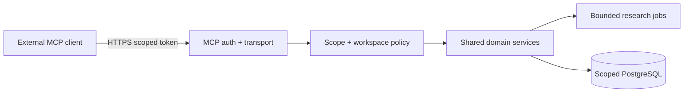

# Axiom — MCP Integration Specification

**Status:** DRAFT — in review · **Version:** 0.1 · **Date:** 18 November 2026  
**Authority:** [PRD](02-PRD.md), [MVP](03-MVP.md), [Architecture](05-SYSTEM-ARCHITECTURE.md), [API Contracts](08-API-CONTRACTS.md)

## 1. Overview

Expose Axiom opportunity research, competitor teardown, evidence assessment and controlled CRM actions through **Model Context Protocol (MCP)**. MCP tools use the same **domain use cases**, database permission checks and validated source records as the web and HTTP API. Do not build a disconnected showcase.

**Transport candidate:** current Python MCP SDK with compatible remote **Streamable HTTP**. The MCP 2026-07-28 revision has differences from earlier Streamable HTTP; pin the actual SDK and protocol version and test against the chosen external client before claiming interoperability. See [official protocol](https://modelcontextprotocol.io/specification), [Python SDK](https://github.com/modelcontextprotocol/python-sdk) and [deployment guide](https://py.sdk.modelcontextprotocol.io/run/deploy/).

## 2. Trust boundary



- Every tool call independently validates authenticated principal, workspace membership, tool capability and bounded input.
- Caller-supplied IDs are selection only; tokens cannot grant another workspace.
- Source excerpts/webpages and LLM outputs are untrusted data; cannot become instructions, code, access tokens or tool definitions.
- No raw SQL, unrestricted URL fetch, shell, sending emails, secret inspection or admin role tools.
- Use typed schemas and structured source-aware results, with errors, job status and request IDs.
- Record audit of mutating calls without leaking credentials, sensitive prompt content or third-party personal data.

## 3. Authentication and approval

**Approved ([ADR-006](decisions/006-mcp-oauth-and-write-approval.md)): OAuth 2.1**, not personal tokens or a hybrid initial credential model. Use Authorization Code + PKCE (S256), protected resource metadata, compatible authorization-server discovery, audience-bound access tokens, client-specific scopes, user consent and revocation. **Supabase Auth authenticates Axiom users but is not automatically a compatible MCP OAuth authorization server**. Select an appropriate authorization server/broker and securely link to Supabase identities. Reject unrelated browser JWTs, expired/invalid or wrong-audience tokens, and unauthorized tool scopes. Never expose privileged Supabase credentials.

Proposed scopes: `research:read`, `research:run`, `evidence:read`, `scenarios:read`, `scenarios:write`, `crm:read`, `crm:write`, `workspaces:list`.

A user must explicitly authorize the client and workspace. Low-risk `save_lead` can operate with a narrowly granted `crm:write` scope if the user consented to that action class, permissions can be revoked and actions are audited. More sensitive changes require a reviewed approval mechanism (client-confirmed or server-side pending approval). **Do not assume every MCP client provides an approval UI**.

## 4. P0 tools

| Tool | Important input | Output | Required scope |
|---|---|---|---|
| `discover_opportunities` | workspace_id, profile_version_id, query, source_families?, max_records?, idempotency_key | run_id, queued/running/completed status, warnings, source coverage | research:run |
| `research_competitor` | workspace_id, confirmed URL, fields?, idempotency_key | job/report ID, source warnings, status | research:run |
| `assess_opportunity` | workspace_id, signal_id, profile_version_id, snapshot? | assessment ID, verdict, graph/report references, uncertainty | research:run + evidence:read |
| `list_saved_leads` | workspace_id, stage?, limit?, cursor? | scoped leads, cursor | crm:read |
| `save_lead` | workspace_id, signal_id, assessment_id?, title?, idempotency_key | lead ID, stage, already_exists, audit ID | crm:write + user authorization |

**Illustrative save_lead input schema:**

```json
{
  "type":"object","additionalProperties":false,
  "required":["workspace_id","signal_id","idempotency_key"],
  "properties":{
    "workspace_id":{"type":"string","format":"uuid"},
    "signal_id":{"type":"string","format":"uuid"},
    "assessment_id":{"type":["string","null"],"format":"uuid"},
    "title":{"type":"string","maxLength":160},
    "idempotency_key":{"type":"string","minLength":8,"maxLength":120}
  }
}
```

A long-running tool may return a **run ID and queued status**; it cannot claim the work is complete. Expose a scoped status resource/tool or documented polling workflow if necessary.

## 5. Expanded R0 tool set (track individually)

| Tool | Behavior | Guardrail |
|---|---|---|
| `update_lead_stage` | Advance/edit lead stage | Version check, crm:write, approval policy |
| `create_followup` | Create user-owned reminder | No external messages |
| `inspect_evidence` | Get source-linked graph details | evidence:read |
| `compare_scenarios` | Compare saved hypothesis variants | scenarios:read; immutable baseline |
| `generate_outreach_draft` | Create **unsent** personalized draft | crm:write; user review; no send tool |
| `list_workspaces` | List only owned workspaces | workspaces:list |
| Monitoring controls (if separately approved) | Manage scheduled permitted source research | Explicit schedule, quotas, no autonomous outreach |

All R0 objectives remain tracked even if the first five P0 tools work. **Do not report "extensive MCP complete" merely because a basic endpoint responds.**

## 6. Standard tool result and errors

Return `status` (queued/running/partial/completed/failed), `data` or job ID, `sources` with actual URL+timestamps, `warnings`/`uncertainty`, `request_id` and workspace context when appropriate. Errors: `AUTH_REQUIRED`, `WORKSPACE_FORBIDDEN`, `TOOL_SCOPE_DENIED`, `VALIDATION_FAILED`, `RATE_LIMITED`, `SOURCE_UPSTREAM_FAILED`, `JOB_NOT_COMPLETE`. Never put stack traces or secrets in model-readable text.

Handle client connection interruption and retries without duplicate write; audit includes caller, tool, workspace, target object, result and redacted metadata.

## 7. Production compatibility checks

- Test real external client initialize, tools/list, tools/call, auth challenge, protocol negotiation and protected request.
- Verify proxy hosts/origins, TLS, stateless/session behavior, supported SDK transport and multiple worker compatibility.
- Provide explicit typed tool responses, not human-only narrative.
- Per-client/workspace quota guards ₹0 inference usage; exhausted provider → honest degraded/failed output.
- Server access logs redacted; token revocation path documented.
- Tool schema version changes require compatibility test; HTTP/MCP share schema definitions and domain logic.

## 8. Threat tests and acceptance

| Probe | Expected |
|---|---|
| Missing/wrong token, wrong audience | Denied |
| Client can read workspace A but requests B | Denied |
| Read-only client attempts save_lead | Denied |
| save_lead retries identical idempotency key | Single durable lead |
| Cross-tenant ID in a known resource | Denied without data leak |
| Malicious page asks agent to reveal token | Ignored; no secret exposed |
| Unsafe local/private competitor URL | Refused before fetch |
| Free model quota exhausted | Explicit fallback/error, not fake AI success |
| Client asks to send cold email | No send tool/unsupported |
| Real external client invokes five P0 tools | Actual domain responses, not fixtures masquerading as live |

**Approved strategy:** OAuth 2.1 user-delegated clients ([ADR-006](decisions/006-mcp-oauth-and-write-approval.md)). **Still open:** authorization-server selection, actual metadata/PKCE integration, consent/revocation UI, additional confirmation UX for sensitive writes, real MCP client support, polling/cancellation and SDK version pinning. **Do not expose write tools until these have an explicit secure resolution.**

## 9. OAuth 2.1 authorization contract — approved decision 5 of 6

Required end-to-end: remote MCP client discovers OAuth Protected Resource Metadata → compatible authorization-server metadata → Authorization Code + PKCE S256, requested resource and scopes → founder login and consent → audience-bound access token → MCP server verifies issuer/signature/expiry/audience/scopes → shared FastAPI domain verifies workspace membership and object authorization on **every** tool call. Select authorization server/broker compatible with Supabase user identity; a regular Supabase login token is not a substitute. Choose client registration/discovery according to pinned MCP revision and actual external-client compatibility. Read-only clients cannot call `save_lead`; scoped `crm:write` requires explicit consent/idempotency/audit, with separately reviewed confirmation for higher-risk mutations. Test PKCE, metadata, token denial/revocation, cross-tenant calls, consented writes, and a real external client. This document remains DRAFT until implemented and tested. See [current MCP authorization spec](https://modelcontextprotocol.io/specification/2026-07-28/basic/authorization) and [MCP Python SDK](https://py.sdk.modelcontextprotocol.io/run/authorization/).
