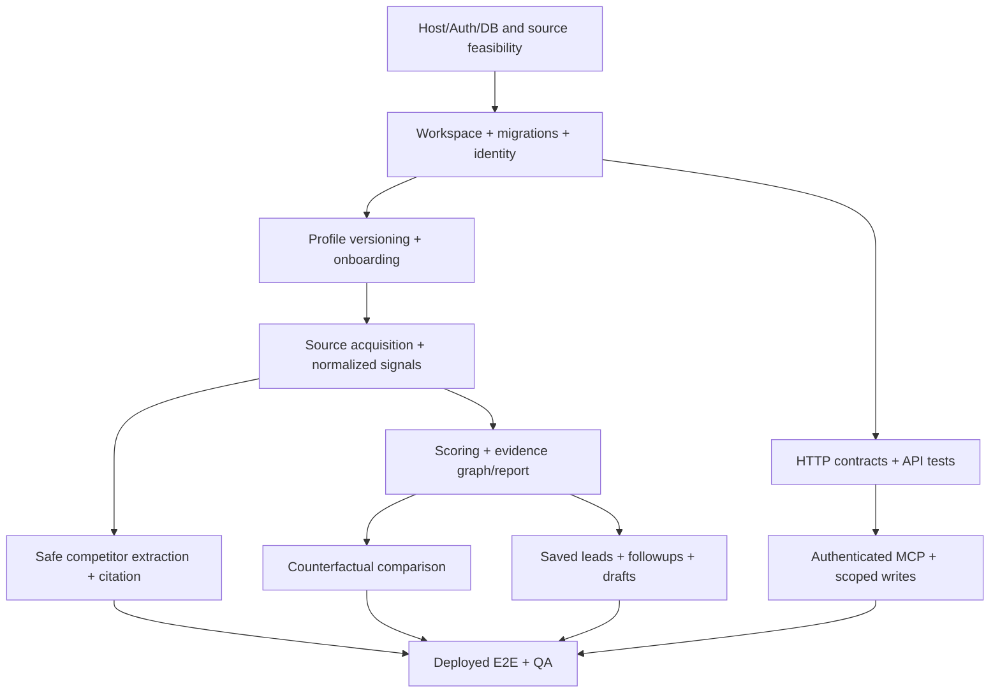

# Axiom — Implementation Roadmap

**Status:** APPROVED — planning baseline and risk gates, not completed engineering · **Version:** 1.0 · **Approved:** 18 November 2026  
**Deadline:** 26 November 2026, 11:59 PM IST  
**Source:** [PRD](02-PRD.md), [MVP](03-MVP.md), [System Architecture](05-SYSTEM-ARCHITECTURE.md), [TRD](06-TRD.md)

## 1. Delivery strategy

Use **tested vertical slices**, not separate weeks of frontend then backend then AI. The first complete user journey is: authenticated workspace → confirm profile → lawful live source → ranked signal → cited competitor → evidence verdict → saved CRM lead → reopen. Then expand to graph, two-scenario comparison and MCP/tool coverage. Every task must include failure and tenant security tests.

**Constraints:** The approved budget is **₹0 planned external AI/research API spend**. Under [ADR-008](decisions/008-managed-hosting-and-worker.md), modest managed-hosting expenditure is allowed; provider/plan costs and a durable worker must still be verified. ₹0 AI/research API spending remains unchanged. A visual shell is not a milestone.

### Workstream dependency graph

## 2. Milestone calendar (targets, not completion claims)

| Date (IST) | Focus | Required proof before moving on |
|---|---|---|
| **18 Nov** | Approved baseline docs, tech choices, repository structure, CI scaffold | One source-of-truth index; no contradictory statuses |
| **19 Nov** | **Early feasibility:** approved auth+DB stack, **actual managed host/worker probe**, real lawful source, real competitor fetch, optional real LLM call | Proven live source URL, sourced competitor excerpt, worker queued job test |
| **20 Nov** | P0 identity/workspace and versioned onboarding | Login + two workspaces with denied cross-user access; confirmed profile |
| **21 Nov** | Discovery normalization, dedupe, ranking and competitor report | Real records + clear evidence timestamps + Unknown price failure case |
| **22 Nov** | End-to-end saved opportunity, evidence model, evaluate full R0 breadth | Browser journey works and owner sees R0 source/CRM/scenario/MCP status |
| **23 Nov** | Interactive graph/report, two+ saved counterfactuals, HTTP and five MCP tools | Scenario snapshot replay, external MCP client and safe CRM write |
| **24 Nov** | Advanced R0 expansion where viable, UX polish, source coverage; freeze nonessential work | Defect/security priority; no speculative new dependencies |
| **25 Nov** | CI/E2E, server/worker outage tests, final deployment, evaluator credentials, source disclosures | Release gate report with passing traces and limitations |
| **26 Nov** | Final URLs, private credentials, README, final smoke and submission before cutoff | Evidence submitted; no hidden fake functionality |

These dates are **targets**, not completion statuses. Do not overpromise which broad source and AI integrations are feasible without actual calls.

## 3. Work packages and acceptance

| Package | Scope | Definition of done |
|---|---|---|
| WP-01 Repository foundation | Next.js/FastAPI layout, environment examples, lint/type/test commands, CI | Clean install and reproducible build |
| WP-02 Auth/workspaces | Session, provisioning, ownership, two product workspaces | Auth failure and cross-tenant tests |
| WP-03 Product onboarding | Adaptive 10–15 questions, confirm/version profile, fallback | Idea and live branches, resume |
| WP-04 Source adapters | HN, permitted RSS, safe URL, R0 third family | Live records, terms registry, honest fail |
| WP-05 Ranking/evidence | Separate intent/fit, validation, four verdicts | False positive, negative, abstention tests |
| WP-06 Competitor intelligence | Confirm URLs, safe extraction, cite claims, unknown | Real sourced public page + export |
| WP-07 Graph/report | Typed nodes/edges, sync report, mobile fallback | Same source IDs, keyboard parity |
| WP-08 Counterfactual Lab | Two+ named alternatives, multiple edits, fixed snapshot | Save/reopen and no revenue forecasts |
| WP-09 CRM | Stages, notes, followups, unsent drafts, history | Durable reopen/idempotency |
| WP-10 HTTP + MCP | Two endpoints, 5 core MCP tools, expanded R0 tools | Real remote client, denied writes |
| WP-11 Release/QA | Production hosting, worker restart, E2E, README and demo backup | All P0 release gates verified |

## 4. Gate-based prioritization and tradeoffs

**P0 release floor:** authenticated deployed app, end-to-end persisted journey, at least two permitted source families targeted with documented limitations if access blocks, 10 clearly labeled examples, real competitor extraction, explainable scoring/verdict, graph+report, CRM, 2 HTTP operations, 5 P0 MCP tools, security tests.

**R0 requested breadth:** 3+ source families, advanced CRM workflows, advanced multi-assumption scenario comparisons, additional MCP tools and exploratory intelligence. **Do not silently defer**. On 19/22/24 November review what is verified, blocked or at risk and present tradeoff to owner; only explicit decision can waive/reduce requirement.

**P1/P2:** scheduled monitoring depth, team collaboration, provider email sending and autonomous campaigns are not default MVP gates. No unauthorized cold outreach under any priority.

## 5. Engineering workflow and review

- Implement small PRs by vertical feature; update docs/index only when approved decisions change.
- Read actual repository `AGENTS.md` and `ENGINEERING.md` before coding; this roadmap does not supersede their quality rules.
- PR description includes requirement IDs (FR, MVP, UF, TRD), design decisions, changed contracts/schema, security impact, test evidence and known limitations.
- Never merge fake live research or fixture-only acceptance as complete.
- Enforce CI build/lint/type tests, API/security/migration tests; run real integration and browser smoke before deploying.
- For database or MCP scope changes, include denied-access and idempotency regression tests.
- Produce deployment logs/traces/screenshots (redacted) tied to commit ID and date; distinguish local and deployed results.
- Maintain a short daily blocker log; escalate host free-tier, source terms, auth or LLM quota issues immediately.

## 6. Open decisions and critical path

**Critical path:** source and managed-worker feasibility → authentication/DB → versioned product profile → source/competitor evidence → decision engine → persistent CRM and scenarios → real MCP client → deployed E2E.

Do not begin sophisticated graph motion before confirming source and storage architecture. Do not declare model inference without actual compatible free provider. Do not deploy MCP writes before approval/authorization semantics are implemented.

**Needed decisions:** Supabase Auth/PostgreSQL/FastAPI and SQLAlchemy/Alembic are approved; managed hosting strategy approved (ADR-008) but **vendor, plan, cost and worker runtime remain unverified**; source registry, model provider and remote MCP auth still need decisions. Use [DECISIONS.md](DECISIONS.md) for open/approved choices.

## 7. Final release evidence

Landing/login/app URL and evaluator account test; live source evidence; 10 labeled examples; sourced competitor; four verdicts including negative/abstain; graph/list parity; two saved scenarios; CRM persistence; tested HTTP/MCP; source/LLM disclosures; dependency/license inventory; backup, CI/E2E, browser/mobile/security test run. Submit without disclosing evaluator secrets in public materials.

**Current implementation status:** No feature is asserted implemented by this document. Only actual code/test/deployment evidence can change a work package to Verified.

## 8. Capacity, effort sizing and delivery risk

**Founder requirement:** plan to support **500 concurrently active founders**, defined and testable in [18-SCALABILITY.md](18-SCALABILITY.md). In the November 26 window, implement stateless API behavior, workspace-indexed database queries, bounded worker concurrency, quota transparency and scalable contracts. Run a meaningful initial load test; any hard 500-user release guarantee requires actual deployed load evidence and a founder-approved gate decision.

The mistakenly introduced separate `T-shirt.md` is not needed. Retain these coarse **relative effort estimates here** without presenting them as guaranteed durations:

| Workstream | Relative size | Risk |
|---|---|---|
| Auth/multi-workspace + RLS | L–XL | Identity and cross-tenant safety |
| Live 2–3+ source families | XL–XXL | Legal access, coverage, throttling |
| Sourced competitor extraction | XL | Website safety and missing data |
| Evidence graph/assessment | XL | Source/graph consistency |
| Advanced Counterfactual | XL–XXL | Frozen evidence and versioning |
| Advanced CRM | L–XL | Persistence and permissions |
| MCP read and write tools | L–XL | Remote client auth and consent |
| Managed API, worker, DB and load capacity | XL–XXL | Provider cost, runtime/worker continuity and measured scaling |
| Full E2E, security and deployment verification | XL | Cross-system integration |

Sizes are directional only and may exceed the available schedule; keep verified P0 vertical slices first while surfacing R0 tradeoffs for explicit owner decisions. **This document's approval does not mean its tasks are finished.**

## 9. Managed hosting decision and implementation next step

Founder-approved [ADR-008](decisions/008-managed-hosting-and-worker.md) permits **modest infrastructure spending** to host the frontend, FastAPI API and separate durable research worker. It does **not** approve a specific billing charge. Prioritize selecting/verifying candidate managed services (e.g. Vercel if its terms suit the actual use, Railway or equivalent for the Python API/worker), proving safe job restart, and recording accepted provider plan pricing. No part of the **₹0 external AI/research API spending** requirement is relaxed.
