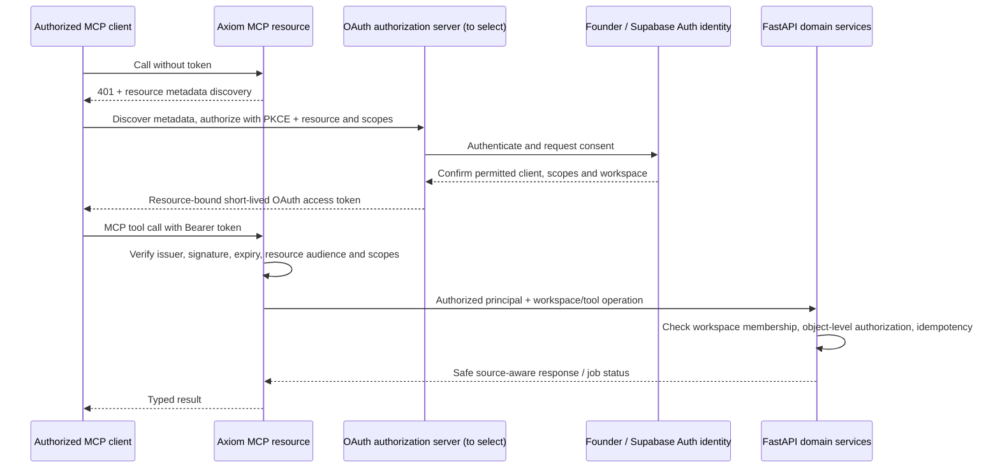

# ADR-006 — OAuth 2.1 Authorization for Axiom Remote MCP

**Status:** APPROVED — OAuth 2.1 strategy and permission boundary; authorization-server provider, scopes UX and interoperability tests pending  
**Date:** 18 November 2026  
**Owner:** Axiom founder — technical decision 5 of 6, Option A  
**Links:** [System Architecture](../05-SYSTEM-ARCHITECTURE.md), [TRD](../06-TRD.md), [MCP Integration](../10-MCP-INTEGRATION.md), [Security](../17-SECURITY.md), [Auth/DB ADR-002](002-authentication-database-and-api-boundary.md)

## Decision

1. **OAuth 2.1 is the selected standard for remote MCP clients**, with delegated, scoped access and user-facing authorization/consent. **Personal API tokens are not the initial MCP authentication mode.** The hybrid OAuth + personal-token option is not selected.
2. The Axiom MCP endpoint operates as a **protected OAuth resource server** behind HTTPS with the compatible Model Context Protocol Streamable HTTP transport. Use **OAuth Authorization Code + PKCE (S256)** for user-facing clients, compliant state/issuer checks, published OAuth Protected Resource Metadata (RFC 9728), and suitable authorization-server metadata (RFC 8414/OIDC Discovery as appropriate). MCP version and interoperability details must match the actual SDK/client and current specification.
3. **Supabase Auth remains the approved user identity mechanism under ADR-002**, but this does not automatically make Supabase Auth an MCP-compatible OAuth 2.1 **authorization server**. Choose/implement an authorization server or compliant authorization broker integrating user login and consent, verify its metadata, client registration/discovery support and correct token issuance before enabling third-party MCP access. Do not simply present a browser Supabase session JWT as a resource-scoped MCP access token.
4. The MCP resource accepts **only tokens issued for the Axiom MCP resource** (audience/resource validation; RFC 8707 where applicable) with correct issuer, cryptographic signature or trustworthy introspection, expiry, granted scopes and subject; reject tokens issued for other apps, user sessions, or upstream APIs. **No token passthrough** to unrelated services; avoid confused-deputy behavior.
5. Define scopes at minimum: `research:read`, `research:run`, `evidence:read`, `scenarios:read`, `scenarios:write`, `crm:read`, `crm:write`, `workspaces:list`. A token's scopes limit available tool actions; they **never bypass workspace membership and object authorization** in FastAPI shared application services.
6. **Explicit user consent:** authorization explains requesting client, scopes and workspace context before token issuance; users may revoke grants. A minimal read-only grant cannot perform `save_lead`. A deliberately authorized `crm:write` grant may allow the low-risk `save_lead` action with idempotency, audit and revocation, subject to owner-approved consent UX; higher-risk mutations (lead-stage changes, follow-ups, drafts or actions with outside-world consequences) need a documented additional confirmation/approval policy. Never assume every MCP client implements confirmation UI.
7. **No automatic outbound messages** are exposed as MCP tools. Models, source HTML and third-party clients cannot authorize more permissions than granted by the user.
8. Use a **single FastAPI domain service layer** for web and MCP. OAuth principals map securely to Supabase-authenticated accounts and workspace membership; authorization is enforced on *each* MCP tool call, not only at handshake. Preserve audit, rate limit, tenant isolation, idempotency, token revocation, source provenance and honest job status.
9. Never commit client secrets, user tokens, service-role keys, evaluator passwords or refresh tokens. Store any secrets securely and redact traces.

## Why Option A

Standards-based user authorization improves connection for regular founders using external MCP clients, avoids manually copying API keys, and offers per-client consent and revocation. This adds more engineering work than personal tokens; it is selected intentionally for a serious multi-user SaaS rather than just a hackathon demo.

**Alternatives rejected:** (B) personal API tokens as the primary onboarding path; (C) hybrid OAuth and API tokens with two concurrent credential models. Future noninteractive machine clients require a *separately approved* flow (possibly an applicable MCP OAuth extension), not silent reuse of a founder's browser token.

## Architecture and scope

This describes the **required protocol outcome**, not an implementation already deployed. Exact authorization-server redirects, RFC metadata and flow parameters must follow the current selected MCP protocol and identity provider.

## Detailed verification and unresolved implementation decisions

- **Authorization-server choice:** evaluate a suitable provider or self-managed compliant broker. Confirm compatibility with Supabase user identities, PKCE S256, required discovery/resource metadata, client ID metadata documents and/or client registration strategy, token audience, refresh/revocation, consent and supported third-party MCP client.
- **MCP spec version:** pin and test the current SDK/protocol together. As of the 2026-07-28 MCP authorization revision, inspect [MCP authorization](https://modelcontextprotocol.io/specification/2026-07-28/basic/authorization), [authorization discovery](https://modelcontextprotocol.io/specification/2026-07-28/basic/authorization/authorization-server-discovery) and [MCP Python SDK authorization](https://py.sdk.modelcontextprotocol.io/run/authorization/). Verify whether the intended clients can use the chosen discovery and registration mechanism.
- **PKCE/redirect protection:** S256, secure redirects, state/issuer handling, HTTPS, short-lived tokens, scope binding and revocation. Validate no token exchange leaks or confused-deputy/token-passthrough.
- **Per-tool consent:** record the exact low-risk `crm:write` grant behavior and higher-risk confirmation mechanism before exposing write actions.
- **Tests:** third-party client initialize, scope grant/deny, invalid audience/issuer/expiry/signature, revoked grant, cross-tenant IDOR, unauthorized write, duplicate save, malformed tool data, job pending, rate limits and audit. Real external-client proof, not a simulated OAuth screen, is required.
- **500 concurrent founders:** bound auth metadata/token verification caching and request load without sharing user or workspace contexts; benchmark after deployment.
- **Not approved as achieved:** OAuth authorization server, MCP account linkage, actual login/consent, production tokens, write approvals, external client support or deployed MCP service.

## Status summary

**Approved:** OAuth 2.1 delegated scoped-client strategy; no initial personal-token mode; consent and least privilege; independent authorization/resource verification; Supabase remains identity system.

**Still open:** concrete authorization-server implementation/provider, client metadata registration compatibility, detailed write-consent UX, actual remote handshake and security tests. **Do not approve the complete MCP integration document or deploy write-capable tools until these checks pass.**
